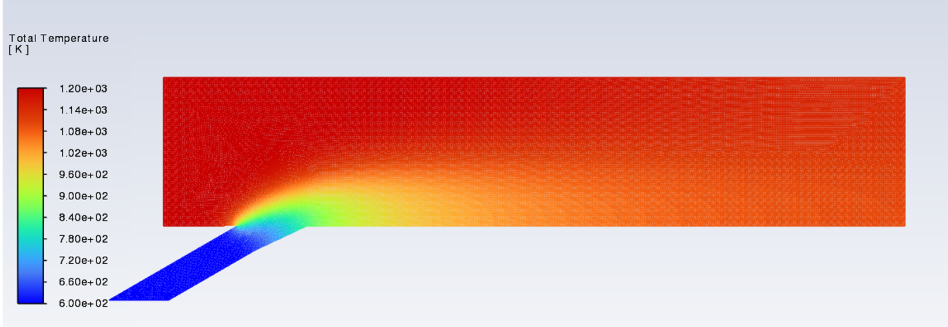
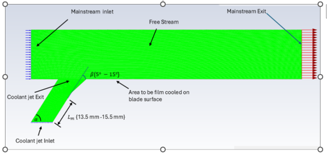
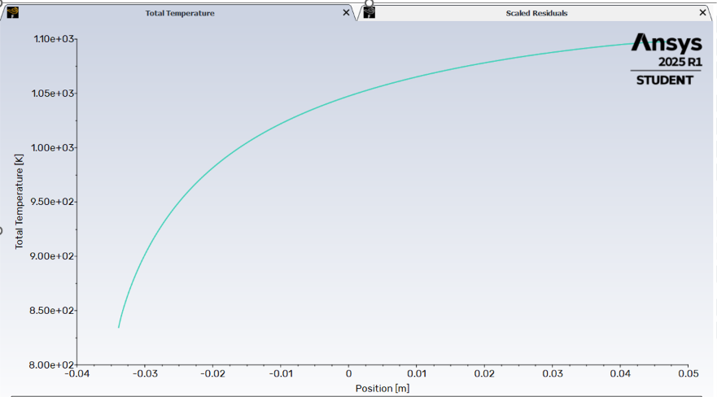

# 2D Film Cooling Simulation: Coolant Jet in a Hot Gas Crossflow

> Steady RANS simulation of film cooling over an adiabatic flat surface, where a shaped-hole coolant jet (600 K) is injected into a hot mainstream crossflow (1200 K) in ANSYS Fluent.



## Concept

Gas turbine blades are protected from extreme hot-gas temperatures by **film cooling**: coolant air is ejected through angled holes in the blade surface and forms a thin insulating film between the metal and the hot mainstream. This project models that process in 2D.

A coolant stream at **600 K** is injected from below through a shaped hole into a horizontal channel carrying mainstream gas at **1200 K** (flowing left to right). The two streams interact as a **jet in crossflow**: the coolant jet bends downstream under the mainstream's momentum, and — if the injection conditions are right — attaches to the surface and shields it.

The bottom wall is modeled as **adiabatic**, so the computed wall temperature is the *adiabatic wall temperature*, the standard reference for film cooling effectiveness:

> η = (T_mainstream − T_adiaabatic wall) / (T_mainstream − T_coolant)

## Geometry


| Parameter | Value |
|---|---|
| Hole type | Shaped (laid-back fan-shaped) hole |
| Injection angle | 30° |
| Forward expansion (laid-back) angle | 5° |
| Metering length | 13.5 mm |
| Hole diameter D | [8] mm |
| Channel height | [15] mm |

## Flow conditions

| Parameter | Value |
|---|---|
| Mainstream temperature | 1200 K |
| Coolant temperature | 600 K |
| Blowing ratio M = ρcVc / ρ∞V∞ | [0.5] |
| Mainstream velocity | [0.1] m/s |
| Coolant velocity | [0.038] m/s |

## Solver setup

- **Software:** ANSYS Fluent 2025 R1 (Student Version)
- **Solver:** pressure-based, steady-state, 2D
- **Turbulence model:** [e.g., SST k-ω]
- **Wall treatment:** adiabatic, no-slip; y+ ≈ [x]
- **Mesh:** [0.2] cells — see `docs/mesh.md`

## Results



Adiabatic wall total temperature along `bottom_wall_chamber_longer_length`, resampled to 400 points ([raw data](results/data/wall_temperature_400pts.csv)). Wall temperature rises from ~838 K just downstream of the coolant hole toward the mainstream temperature (~1100 K) as the coolant film mixes out — the direct precursor to the film cooling effectiveness η(x) analysis.

The contour above shows the coolant jet bending into the mainstream and forming a cooler film along the lower wall. Downstream of injection, near-wall temperatures remain well below the 1200 K mainstream before turbulent mixing gradually erodes the film.

- Film cooling effectiveness vs. x/D: `results/plots/eta_vs_xD.png` *(in progress)*
- Convergence history: `results/plots/convergence.png`

## Repository structure

```
├── README.md
├── docs/
│   ├── geometry_schematic.png        # geometry and boundary-condition diagram
│   ├── setup.md                      # (planned) full boundary conditions and solver settings
│   └── mesh.md                       # (planned) mesh strategy, cell count, y+
├── results/
│   ├── contours/
│   │   └── total_temperature_contour.png
│   ├── data/
│   │   └── wall_temperature_400pts.csv   # wall temperature, 400 points
│   └── plots/
│       └── wall_temperature_xy.png
└── postprocessing/
    └── make_eta_plot.py              # (planned) computes eta vs. x/D from Fluent XY export
```

## How to reproduce

1. Requirements: ANSYS Fluent 2025 R1; Python 3.x with `numpy`, `matplotlib`
2. Case/data files are not stored here (GitHub file-size limits) — boundary conditions in `docs/setup.md` are sufficient to rebuild the case
3. Post-processing: place the Fluent XY export in `results/data/`, set the CONFIG block in `postprocessing/make_eta_plot.py`, and run it

## Status & next steps

- [x] Baseline adiabatic simulation converged
- [ ] Wall temperature data export + effectiveness plot
- [ ] Mesh independence study
- [ ] Parametric study: effect of blowing ratio on film attachment
- [ ] Validation against published shaped-hole experimental data
- [ ] Extension to conjugate heat transfer (3D blade)

## Contact

[Akinbowale] — [https://www.linkedin.com/in/akingbola-akinbowale-phd-candidate-522851341/] — PhD Researcher, [University]
